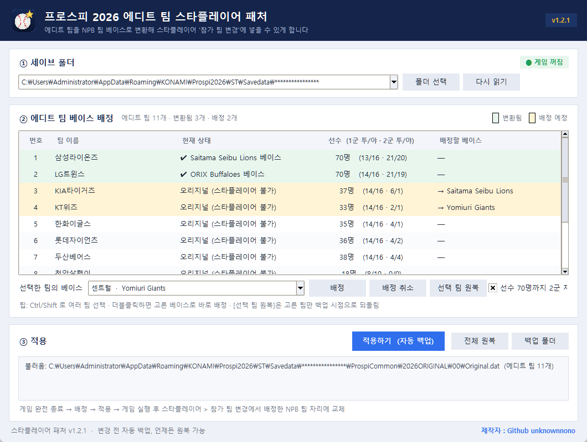

# 프로스피 스타플레이어 패처

**프로스피 2026의 에디트 팀(쉐어 받은 오리지널 팀 포함)을 스타플레이어에서 쓸 수 있게 해 주는 Windows용 로컬 프로그램입니다.** 진행 중인 스타플레이어 세이브의 팀을 에디트 팀으로 바꾸거나(v1.3~), 에디트 팀을 NPB 팀 베이스로 변환해 참가 팀으로 넣을 수 있습니다.

현재 공개 버전: **v1.3.5**

[최신 버전 다운로드](https://github.com/unknownnono/ProspiStarPlayerPatcher/releases/latest)

> 다운로드 페이지의 **Assets**에서 `ProspiStarPlayerPatcher_v1.3.5_Windows.zip`을 받으세요. GitHub가 자동으로 제공하는 `Source code (zip)`과 `Source code (tar.gz)`는 실행 프로그램이 아닙니다.

## ★ 권장: 진행 세이브 편집 (v1.3~)

에디트 팀으로 스타플레이어를 **처음부터 시작하면 게임이 2군 일정을 만들지 않습니다.** 평가전 결과로 2군에 배정되거나 시즌 중 강등되면 2군 경기가 계속 "휴일"입니다. (세이브 수정으로는 해결할 수 없음을 확인했습니다.) 그래서 아래 방법을 권장합니다.

1. 게임에서 **NPB 팀으로** 스타플레이어를 처음부터 시작해 선수를 만들고 저장합니다.
2. 게임을 완전히 종료합니다.
3. 패처 메인 화면의 **[진행 세이브 편집]** → 저장한 슬롯 선택 (00번은 게임 자동 저장)
4. 위쪽 **[★ 여러 팀 한 번에 바꾸기]**(v1.3.4~)에서 12팀마다 넣을 에디트 팀을 고르고 **[바꾸고 저장]** — 상대 팀까지 선수 + 타순·투수 보직 + 팀 이름 + 외형을 한 번에 저장합니다. (자동 백업)
   - 한 팀만 바꿀 때는 [선수 교체] 탭에서 에디트 팀을 고르고 **[★ 에디트 팀 통째로 가져오기]** → 각 탭 확인 → **[저장하기]**
5. 드래프트 신인 이름이 일본식이면 편집 창 아래쪽 **[신인 한국 이름으로]**(v1.3.5~) — 아래 설명 참고

| 탭 | 하는 일 |
| --- | --- |
| 선수 교체 | 칸 단위 교체 / 팀 전체 자동 교체 (같은 군·포지션 우선, 스타 칸 제외) |
| 1군 / 2군 | 1군 등록 (최대 31명) |
| 타순 · 수비 | 지명 있음/없음 타순과 수비 위치, 주 포지션 자동 편성 (메뉴용·경기용 라인업 함께 저장) |
| 투수 보직 | 선발·중계·셋업·마무리, 자동 배치 |
| 팀 이름·외형 | 게임에 에디트 팀 이름 표시, 팀 색상 / 엠블럼·마크 / 경기 중 유니폼 선택 적용 |

- 해설의 팀 호칭 음성과 외모 에디트 화면의 유니폼 미리보기는 공식 팀 그대로입니다.
- 진행 세이브 백업: `문서\프로스피2026 에디트팀 패처 백업\<스팀ID>\스타플레이어 진행세이브\`, 편집 창의 [백업에서 되돌리기]로 복원.

### 드래프트 신인 한국 이름 (v1.3.5~)

1년차 이후 드래프트로 들어오는 신인이 일본식 이름(한글 표기)으로 나오는 것을 한국식 이름으로 바꿉니다.

- 편집 창 아래쪽 **[신인 한국 이름으로]** → 커리어 중 드래프트로 들어온 선수 목록
- 기본 체크는 에디트(KBO) 팀의 일본식 이름 신인. NPB 팀 신인도 바꾸려면 [전 팀 일본식] 또는 직접 체크
- 이름과 읽기만 바뀌고 능력치·얼굴·기록은 그대로. 같은 선수는 항상 같은 이름이 나옵니다.
- 등록명이 있는 선수, 한자 이름(레전드), 이미 한국 이름인 선수는 기본 제외
- 드래프트가 지날 때마다 다시 쓰면 새로 들어온 선수만 대상이 됩니다.

## 에디트 팀 베이스 변환 (②)

스타플레이어 모드는 기본적으로 NPB 팀만 고를 수 있고, 처음부터 만든 "오리지널" 에디트 팀은 참가 팀으로 넣을 수 없습니다. 이 패처는 게임의 에디트 데이터(`Original.dat`)만 수정해서, 에디트 팀이 지정한 NPB 팀의 자리를 대신 차지할 수 있게 만들어 줍니다.

게임 실행 파일은 건드리지 않습니다. 세이브의 에디트 데이터만 바꾸며, 변경 전에는 항상 자동으로 백업하고 언제든 되돌릴 수 있습니다.

| 단계 | 하는 일 |
| --- | --- |
| ① 세이브 폴더 | 세이브 폴더를 자동으로 찾아 에디트 팀 목록을 표시 |
| ② 베이스 배정 | 에디트 팀마다 어떤 NPB 팀 자리에 넣을지 지정 |
| ③ 적용 | 자동 백업 후 변환 (헤더·선수 수·베이스 값 한 번에 처리) |
| 선택 팀 원복 | 고른 팀만 원하는 백업 시점으로 되돌림 |
| 전체 원복 | 에디트 데이터 전체를 백업 시점으로 되돌림 |

## 주요 기능

- 세이브 폴더와 에디트 팀 목록 자동 인식 (스팀 계정이 여러 개면 선택)
- 에디트 팀을 NPB 12팀 중 원하는 베이스로 변환
- "오리지널 팀은 사용할 수 없습니다" 제약 해제
- 선수 수 부족 시 2군 선수 70명까지 자동 채우기 (한국식 이름·고유 번호)
- 베이스가 다른 팀 교체 제약 해제
- 변경 전 자동 백업, 선택 팀 단위/전체 원복
- 게임 실행 중이면 적용·원복 차단, 저장 전 재검증

## 설치 및 첫 실행

### 필요한 환경

- Windows 10/11 64비트
- 프로스피 2026 (eBaseball PRO SPIRIT) 설치 및 스타플레이어 플레이 기록
- 별도 설치 불필요 — zip을 풀면 바로 실행됩니다. exe와 같은 폴더의 `_internal` 폴더가 함께 있어야 합니다.

### 빠른 시작

1. 다운로드한 zip을 풀고 `스타플레이어 패처 v1.3.5` 폴더 안의 `스타플레이어 패처 v1.3.5.exe`를 실행합니다.
2. **게임을 완전히 종료**합니다. (게임이 켜진 채로 저장하면 변경 내용이 덮어써집니다.)
3. 목록에서 팀을 고르고(Ctrl/Shift로 여러 개), 아래에서 베이스 NPB 팀을 고른 뒤 **[배정]**.
4. **[적용하기]**를 누르면 현재 파일을 자동 백업한 뒤 저장합니다.
5. 게임 실행 → 스타플레이어 → 참가 팀 변경 → 위쪽에서 배정한 NPB 팀 선택 → 아래 에디트 팀 탭에서 해당 팀을 골라 교체합니다.

## 베이스 배정과 리그

- 에디트 팀은 **배정한 NPB 팀의 자리**에만 들어갑니다. 그 NPB 팀의 리그(센트럴/퍼시픽)를 따릅니다.
- 같은 베이스를 여러 에디트 팀에 배정해도 됩니다. 게임의 참가 팀 변경에서 그 자리에 넣을 팀을 그중에서 고르면 됩니다.
- 목록에서 이미 변환된 팀은 초록색, 배정 예정인 팀은 노란색으로 표시됩니다.

## 선수 자동 채우기

스타플레이어는 참가 팀에 일정 수 이상의 투수·야수(2군 포함)를 요구합니다. KBO 에디트 팀은 1군만 등록된 경우가 많아 그대로는 참가가 막힙니다.

- "선수 70명까지 2군 자동 채우기"를 켜면 부족한 2군 선수를 자동으로 채웁니다.
- 능력치·외모는 다른 에디트 팀의 실제 2군 선수를 바탕으로 하고, 이름은 한국식으로 새로 생성해 겹치지 않는 고유 번호를 부여합니다.

## 백업과 원복

- 적용·원복 전에는 항상 현재 파일을 자동으로 백업합니다.
- `Original_최초원본.dat`은 패처를 처음 적용하기 전 상태입니다.
- **선택 팀 원복**: 고른 팀만 원하는 백업 시점으로 되돌립니다. 다른 팀은 그대로 유지됩니다.
- **전체 원복**: 에디트 데이터 전체를 되돌립니다.
- 백업 위치: `문서\프로스피2026 에디트팀 패처 백업\<스팀ID>\`

## 보호

- 실행 파일은 난독화되어 있어 내부 코드가 쉽게 추출·변조되지 않습니다.
- 핵심 로직이 변조되면 시작 시 자가검사에서 걸러져 실행을 거부합니다.
- 서명되지 않은 프로그램이라 처음 실행할 때 SmartScreen이나 백신 경고가 날 수 있습니다. 정상이며, "추가 정보 → 실행"으로 진행하면 됩니다.

## 자주 발생하는 문제

### 세이브 폴더를 찾지 못합니다

스팀을 기본 위치가 아닌 곳에 설치했거나 세이브가 없는 경우입니다. **[폴더 선택]**으로 `...\KONAMI\Prospi2026\ST\Savedata\<숫자>` 폴더를 직접 지정하세요.

### 적용했는데 게임에서 바뀌지 않았습니다

게임이 켜진 채로 저장하면 게임이 예전 상태로 파일을 덮어씁니다. **게임을 완전히 종료한 뒤** 적용하고, 적용 후 게임을 다시 실행하세요.

### 참가 팀 변경에서 여전히 오류가 납니다

해당 팀을 적용했는지, 적용 후 게임을 재시작했는지 확인하세요. 1군 선수가 매우 적은 팀은 자동 채우기만으로 부족할 수 있습니다.

### 프로그램이 "변조된 것으로 보입니다"라고 뜹니다

파일이 손상됐거나 백신이 일부를 수정한 경우입니다. 릴리즈에서 원본 zip을 다시 받아 실행하세요.

## 지원 범위와 주의사항

- 게임·패치 업데이트로 세이브 구조가 바뀌면 동작하지 않을 수 있습니다.
- 로고·유니폼은 게임이 베이스 NPB 팀 리소스를 따를 수 있고, 등번호가 겹칠 수 있습니다.
- 드래프트 신인 이름은 게임이 생성한 뒤 진행 세이브 편집의 [신인 한국 이름으로]로 바꿔야 합니다(자동으로 바뀌지 않음).
- 에디트 팀 데이터 자체는 포함하지 않습니다. 사용자 PC에 이미 있는 에디트 데이터만 변환합니다.

## 제작 및 배포

제작: **Github [unknownnono](https://github.com/unknownnono)**
